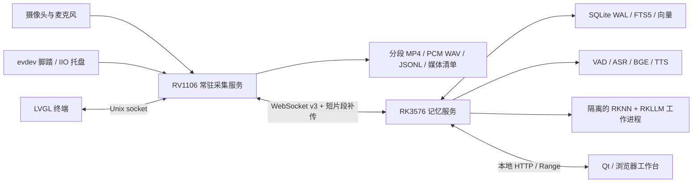

# 架构与数据约定

## 设备所有权与证据

只有采集服务打开相机和录音设备。LVGL 退出不会结束正在进行的会话。VI 的 NV12 帧直接绑定 VENC，记录队列只持有压缩后的 H.264 包；低分辨率变化检测持有自己的灰度副本。Qt 使用拥有数据的 QImage，异步 AI 从闭合的原始媒体取帧，不持有显示缓冲。

Echo 的原始媒体保留在会话目录，中枢缓存收到的原始字节并核验长度和 SHA-256。中枢通过 HTTP Range 提供回看。当前采用 WebSocket 上传完整的约 10 秒短片段，以减少内存较小的终端上的常驻网络组件；获取仍是按需的。连续录音片段会优先用于本地 ASR，背景图像任务只针对锚点。

采集线程关闭原始文件后，把路径、来源时间和所属会话交给长度为 16 的待登记队列。WAV 数据与目录同步、摘要计算、清单提交和事件日志同步由服务主循环依序处理，停止会话时先排空该队列。ALSA 硬件缓冲默认请求 500ms，可通过 `capture_latency_us` 在 80ms～1s 范围内配置；状态结构只分配一次，避免逐次循环累积栈内存。状态快照串行提交，断线期间也继续更新。500ms 与异步 WAV 同步版已完成独立一小时复测，0 次 XRUN，原件全量巡检通过，终端采样最低可用内存 21.59MiB。此前五分钟压力低值为 19.81MiB；250ms 旧版一小时的两次 XRUN 分别保留报告。RK3576 尾段仍观察到 zram 换出，未通过零换页验收。

证据接口另外返回 `echotrace-playback-v1` 清单，包含同一启动时钟下的起止时间、声画片段、摘要和缺失区间。Qt 和浏览器按这份清单自动续播，并在整个证据范围内跳转；超过 50ms 的视频间隔会暂停，尚未缓存的下一段也会暂停，不把缺口压缩成连续过程。音频与视频可以有不同的分段边界。

Qt 仍复用原有 `RecordingPlayer/FFmpegDecoder`。新增控制器流式下载、校验并预取下一片段，使用临时目录保存有限的证据范围，切换选择时释放缓存；跳转会重建解码状态并忽略旧请求回调。复用适配修复了暂停跳转等待、关键帧回退、非零 PTS 起点和时长计算，并把播放节拍改为单调时钟。Echo 声音控制请求串行发送，暂停、跳转和换片都会重新确定声音位置。

`events.body` 保存原始观察，写入后不可改写。用户笔记保留修订历史，ASR、视觉描述和模型版本单独保存。VAD 确定的语音片段可派生子锚点，保存父事件、样本范围和模型来源；导出时带上原始父事件。

## 时间

同一次 RV 启动使用 `CLOCK_MONOTONIC` 微秒。媒体登记包含 `device_id, boot_id, start_us, end_us`。音频使用 ALSA 单调时间戳与样本计数，视频保留源 PTS；若底层 PTS 与单调时间存在明显固定偏移，会登记该偏移与“待声画实验验证”的状态。网络到达时间不参与证据定位。

当前声卡只接受 2～4 通道，已在实板确认左侧 ADC 有效。因此按双声道硬件采集，取左声道写入 16kHz、16bit 单声道 WAV。其他硬件可通过 `capture_channels`、`microphone_channel` 配置。

`boot_id` 隔离重启后的时间。UTC 和 `clock_quality` 仅用于显示；当前设备的墙钟不能用于推断真实拍摄日期。脚踏的 evdev 时钟设置为单调时钟；IIO 时间戳只表示主机触发采样锚点。

## WebSocket v3

首条消息为 `hello`，包含版本、设备 ID、启动 ID、源时间和采集状态。控制命令带唯一 ID，设备完成动作后回复 ACK。事件以 `(device_id, boot_id, seq)` 和事件 ID 双重去重：同一身份的不同内容返回冲突。

二进制头为 24 字节网络字节序：

| 字段 | 字节 |
|---|---:|
| 版本 | 2 |
| 类型：1 Opus / 2 媒体块 | 2 |
| 负载长度 | 4 |
| 序号 | 4 |
| 来源时间 µs | 8 |
| 首包对应样本数 | 4 |

Opus 必须独立保留包边界、每包 640 样本；当前录制与离线识别的权威音频为闭合 WAV，尚未把实时 Opus 收包当作已经实现的低延迟识别。媒体块最多 64KiB，序号严格递增，声明长度和摘要一致才原子提交。

本版协商 `media_chunk_ack` 能力：终端在 hello 中声明，中枢确认支持后每个媒体块返回媒体 ID 和序号。终端每次最多发送一个 16KiB 未确认块，给命令和心跳留出传输机会。块 ACK 只用于流量控制；整段通过长度、SHA-256 和 fsync 校验后才提交。旧中枢不确认该能力时回退到原 64KiB 上传形式。

同一时刻只允许一次连接握手，收到中枢 hello 后才开始补传。关闭回调只更新自己所属的连接，上传序号和文件位置也绑定对应连接。重复获取同一媒体不会重复占用终端上传队列；语音任务只请求其所需音频，不为转写额外排队下载视频。

断线时继续写盘。重连分批读取 JSONL，避免把全天日志装进普通内存；媒体路径按清单查询。一次上传中断后从该短片段开头重试，不拼接未经确认的残余数据。删除产生中枢墓碑，终端离线时延迟删除原件，重连后执行；旧日志不会使已删除会话复活。

## AI 与回答

CPU 识别与检索模型分别加锁，视觉模型在独立进程内串行运行。关键帧不做实时逐帧 VLM；自动候选限速，人工标记先持久化。助手回放污染的音频片段带 discontinuity，跳过用户笔记转写。

查询合并分词全文检索与归一化文本向量，过滤项目/会话。默认回答从检索到的用户笔记、转写或描述中引用，不让模型编造证据 ID、时间和因果。最后位置附“历史记录不能证明当前位置”的限制。视觉问题缺少可用媒体时返回 unavailable。

会话摘要目前是可编辑的按时间排列的观察摘要；它不把视觉模型的猜测转换成事实。完整行业准确率仍需自采数据验收。
