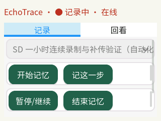
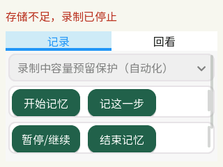

# SD 卡接入与一小时记录

日期：2026-11-12。新版异步 WAV 提交与 500ms 请求缓冲已完成独立一小时复测：0 次音频 XRUN，702 个原件全部通过摘要与容器巡检。旧版一小时的两次 XRUN 和五分钟压力测试的 19.81MiB 内存低值保留，分别报告。零换页目标和一小时物理声画同步仍未通过验收。

## 存储和迁移

- SD 型号字符串为 `SD64G`。分区 `/dev/mmcblk1p1` 挂载到 `/mnt/sdcard`，FAT32，文件系统容量 62,327,717,888 字节，约 58.05GiB。
- 沿用已有文件系统，没有分区或格式化。独立片段远小于 FAT32 单文件上限。
- 16MiB 文件写入、fsync、重命名和摘要读回通过，写入及同步约 0.95 秒，读取约 1.04 秒。这是有界文件测试，不是全卡容量鉴定。
- 已将 `/root/echotrace/smoke` 的 7,075,519 字节迁移到 `/mnt/sdcard/echotrace`，核验 4 个原始媒体。原 NAND 目录和原始日志字节保留。

证据：[存储检查](storage-preflight.json)、[迁移记录](storage-migration.json)。

## 长测观察

会话：`22f8c0fb-1971-4204-8d98-6a9e8d976ab0`。该会话是自动化稳定性测试，未用于真实操作检索质量评测。已逐一核验全部 SD 原件的摘要、样本表、WAV 格式和样本数，并与中枢清单比对身份、时间、字节数、摘要及异常标记。

| 项目 | 观察结果 |
|---|---|
| 录制时长 | 控制器运行 3600.001 秒，停止命令正常完成 |
| 视频清单 | 342 段，1,215,943,313 字节，累计来源时长 3600.517 秒 |
| 音频清单 | 360 段，115,208,880 字节，累计样本时长 3599.783 秒 |
| 原件巡检 | 702 个全部通过，无未完成文件、漏登记原件或摘要不符 |
| 视频样本表 | 共 90,013 帧，平均 25.00001fps，全部为 1920×1080；未发现超过 60ms 的片内样本间隔 |
| 终端普通内存 | 最低 MemAvailable 20,904kB，即 20.41MiB |
| 中枢内存 | 最低 MemAvailable 2,222,804,992 字节，即约 2119.83MiB |
| 视频相邻清单时间 | 最大间隔 291µs，最大重叠 286µs；这不代替逐帧检查 |
| 音频异常 | 2 次 XRUN，较大缺口分别为 297.805ms、279.835ms |
| 中枢停服 | 轮询观察接口不可用约 40 秒；终端离线状态仍为 recording，恢复后原有记录保留并补传 |
| 界面重启 | 采集 PID 与启动时间保持不变，随后仍持续登记分片 |

该轮采集程序 SHA-256：`193fb8de164f9e693eff731003304f0b57958897de779307e8c795c9c078b916`。它使用 250ms ALSA 缓冲、异步媒体登记，但 WAV 关闭仍同步执行 fsync。后续音频改动没有混入这轮测试结果。

此前的一分钟复测未出现音频异常；长测进一步暴露了两次 XRUN，因此短测不能代替长期验收。一次异常出现在中枢停服与原件读回重叠时段，另一次出现在约第 44 分钟。现有记录不足以单独确定根因。

另一个原始片段已完整解码：1920×1080、275 帧、10.999511 秒，容器解析和 FFprobe 的帧数一致。它只证明该片段的格式和解码结果。

证据：[长测摘要](sd-hour-observations.json)、[全量原件巡检](sd-hour-audit.json)、[指标汇总](sd-validation-summary.json)、[完整采样与媒体清单](sd-hour-session.json)、[终端资源采样](sd-echo-resources-hour.tsv)、[停服恢复](sd-outage-check.json)、[界面重启](sd-ui-restart.json)、[抽样解码](sd-preflight-decode.json)。样本表巡检不等于全场逐帧图像解码，也未测量物理声画同步。

## 新版五分钟压力复测

会话：`698f9f1a-4a4b-4f4e-a364-2a4f6a4fb852`。程序 SHA-256 为 `538c4688c9e94e244a6949ad56a53cb3095ddeef8ab3b4b516654f6d8373fd40`，实板执行文件摘要与构建产物一致。

| 项目 | 实测结果 |
|---|---|
| 录制 | 300.004 秒正常结束，29 段视频、30 段音频 |
| 读卡负载 | O_DIRECT 绕过内核页缓存，64 轮读取并通过 SSH 传输，共 1GiB，持续约 285.75 秒；只读原件 |
| 音频 | 0 次 XRUN，0 段音频异常标记；最大段间时间间隔 151µs |
| 原件 | 59 个全部通过 SHA-256 与容器巡检，和中枢清单逐项一致；视频样本表共 7,510 帧 |
| 终端内存 | 最低 MemAvailable 20,284kB，即 19.81MiB，比 20MiB 预留目标低约 0.19MiB |
| 中枢内存 | 最低 MemAvailable 约 2138.68MiB |

该压力负载下未观察到 OOM，终端内存余量仍需收敛。五分钟结果不代替新版一小时长期验证，也不证明物理声画同步误差达标。旧版的一小时结果保留两次 XRUN，没有用短测覆盖该结果。

证据：[新版摘要](sd-deferred-summary.json)、[压力录制明细](sd-deferred-pressure-session.json)、[直接读卡负载](sd-direct-read-pressure.json)、[新版原件巡检](sd-deferred-audit.json)、[资源采样](sd-echo-resources-deferred.tsv)、[RV1106 交叉构建](build-rv1106-deferred.log)、[RV1106 原生核心检查](core-deferred-rv1106.log)。

## 本次改动与验证范围

### 新版一小时复测

会话 `78aed7c4-3ecb-4f8d-b475-50a19c08bfb9`，采集程序摘要 `538c4688c9e94e244a6949ad56a53cb3095ddeef8ab3b4b516654f6d8373fd40`。与前述五分钟测试使用同一采集二进制。

| 项目 | 实测结果 |
|---|---|
| 控制时长 | 3600.010 秒，正常停止 |
| 视频 | 342 段，1,730,100,769 字节；样本表共 90,010 帧，平均 25.00002fps，全部 1920×1080 |
| 音频 | 360 段，115,221,136 字节；57,602,648 个 PCM 样本，0 次 XRUN、0 段音频异常标记 |
| 原件巡检 | 全部 702 个摘要、容器与样本数通过，源端和中枢登记字段一致，无未完成文件或漏登记原件 |
| 终端内存 | 699 次录制期采样，最低 MemAvailable 22,112kB，即 21.59MiB |
| 中枢内存 | 最低 MemAvailable 1066.66MiB；本轮还执行过 RK3576 编译与回归负载 |
| 只读压力 | 一段约 120 秒的 O_DIRECT 读卡及 SSH 传输，完成 448MiB；没有填充 SD 卡 |
| 段间时间 | 音频最大间隔 331µs；不代表物理声画误差 |
| 控制标记 | 12 次经 SSH 链路的 HTTP 往返，P95 367.48ms；未测脚踏反馈 |

尾段另采样约 356 秒的 RK3576 全局 VM 计数：zram 换出 22,831,104 字节、换入 86,016 字节，内核 OOM 计数增量为 0。该板同时运行原有 NAS 服务，数据不能归因于某个进程，也不能据此宣称整小时无换页。没有改动系统的 swappiness、zram 或 NAS 配置。

证据：[一小时汇总](sd-hour-v6-summary.json)、[完整会话](sd-hour-v6-session.json)、[原件巡检](sd-hour-v6-audit.json)、[终端采样](sd-echo-resources-hour-v6.tsv)、[只读负载](sd-hour-v6-read-pressure.json)、[尾段 VM 计数](sd-hour-v6-rk-vm.json)。

### 容量保护、界面与物理短测

新增故障提示后，采集二进制为 `887640eb68356ce15d18311817eb947cf2e3f6fa3e685c52a3535bb3b34adeee`。音视频采集实现未改动；这一新二进制没有重新做独立一小时测试。

通过临时提高预留空间阈值，在真实相机录制期间触发容量保护：采集停止、片段关闭，故障原因保留，恢复请求返回 HTTP 409。SD 卡没有被填满，默认配置恢复为 256MiB 预留。屏幕顶部直接显示存储不足提示，避免错误详情藏在回看页。启动脚本的 PID 所有权、重复启动和独立重启已在实板验证。

证据：[启动前容量拒绝](storage-reserve-hardware.json)、[录制中容量保护](storage-reserve-live.json)、[独立界面服务](terminal-service.json)、[协议回归（主机）](tests-integration-capture-fault-host.log)、[协议回归（RK3576）](tests-integration-capture-fault-rk3576.log)。

用户配合三组双击拍手，已在约 87 秒短测中逐帧核对六次可见接触及音频峰值，详见 [物理短测记录](physical-av-sync.md)。它与整小时稳定性数据分开，不合并为一小时同步通过。

1. 修复慢握手期间重复建连、旧连接回调干扰新连接、关闭连接返回 HTTP 500 的问题。回归覆盖延迟握手、持续分片、标记、下载及上传途中断线重传。
2. 协商逐块确认，限制未确认媒体数据，减少慢 SSH 链路中视频上传对控制命令的阻塞；同一媒体请求在终端去重。
3. 移出采集线程中的摘要计算和日志提交，串行写状态快照，修复 ALSA 状态结构在循环中反复 alloca 的栈增长风险。
4. 新版进一步把 WAV 的数据和目录同步移到媒体清单提交之前，默认请求 500ms 硬件缓冲，补充 ALSA 错误码，忽略无数据丢失的 EINTR。已完成主机和 RK3576 回归、固定 SDK 交叉构建及 RV1106 原生核心检查，并已部署到板端。
5. 终端录制时跟随当前会话项目并锁定选择，红色显示录制状态。界面已在实板更新并通过屏幕读回检查。

测试报告见 [主机回归](tests-host-sd.log)、[RK3576 回归](tests-rk3576-sd.log)、[存储工具负例](tests-storage-host.log)。单元测试中的模拟素材不作为录制质量或识别准确率证据。

## 连接恢复与后续验证

WSL 跳板曾在录制结束后无法连接，Echo 的 SSH 通道随之断开。恢复后已确认 Echo 启动 ID 未改变、采集服务已停止、SD 正常挂载；随后完成了全部原件巡检和新版部署。

新版一小时稳定性复测已完成，原件保留在 SD。用户选择保持当前接法，真实 USB 直连与拔插、断电恢复、脚踏和称重外设仍需另行验收。物理同步目前只有短测，尚无整小时数据；没有采集人工检索题集。
