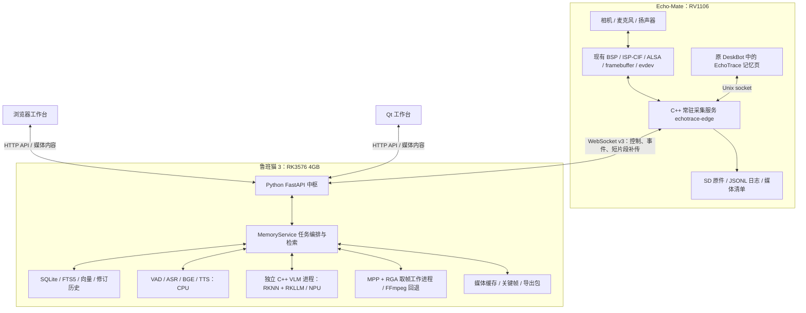

# EchoTrace 软件架构、功能与使用手册

核对日期：2026-11-13。本文以当前源码和实际部署为准，描述 0.1 核心首版。EchoTrace 现已作为原 Echo-Mate DeskBot 的“记忆”应用试运行；原聊天、AI 相机等页面保留。集成细节见 [DeskBot 集成说明](../integration/deskbot/README.md)。

EchoTrace 面向开发板接线、维修、拆装等动手工作：保存操作现场、当时的口述和步骤标记，之后按文字或语音找回相关记录，并回到原始声画验证。当前已经形成采集、记录、索引、检索、证据回放的闭环，尚未完成完整产品验收。

## 1. 整体组成与实际连接

系统由 RV1106 采集端、RK3576 记忆中枢、三个交互入口组成。



部署目标是 Echo USB 网卡直接连接鲁班猫 USB Host。目前按用户选择保留原接法：

```text
Echo-Mate USB → Windows/WSL
                    ↑ SSH 跳板
                  当前 Mac
                    ↓ SSH 转发
                鲁班猫记忆服务
```

模型推理在本地板卡运行，但当前调试链路仍依赖 WSL 和 Mac。不能把它描述成已经完成两板脱离电脑独立使用。

| 打开浏览器的位置 | 地址 | 对应内容 |
|---|---|---|
| 当前 Mac | http://127.0.0.1:18084 | 实板工作台，经 SSH 转发到鲁班猫 |
| 鲁班猫自己的图形桌面 | http://127.0.0.1:18081 | 同一实板中枢 |
| 当前 Mac | http://127.0.0.1:18081 | 当前独立模拟演示，不是实板库 |

上述 localhost 属于打开浏览器的那台电脑。鲁班猫当前服务仅监听回环地址，不能直接用其 LAN 地址加 18081 当作已开放的网站。

## 2. 两块板的职责

| 部件 | 当前职责 | 为什么这样分工 |
|---|---|---|
| RV1106 | 摄像头、音频、硬件编码、SD 记录、事件、本地控制、补传、扬声器播放 | 原件先在现场保存，避免网络或 AI 故障中断记录 |
| RK3576 | 离线模型、数据库、文本与向量检索、关键帧提取、证据缓存、HTTP 服务 | 集中承担较大的内存与推理负载 |
| DeskBot / LVGL | 原桌面保留；新增记忆页负责开始、标记、暂停、结束、状态和查询结果显示 | 录制时通过共享设备锁阻止原聊天和 AI 相机争抢声画 |
| Web / Qt | 项目管理、详细时间线、文字查询、回放、笔记、导出 | 大屏更适合复盘 |

本块 Echo 的运行中设备树为 128MiB 内存，约 66MiB 用于媒体 CMA，Linux 普通内存约 54MiB。当前没有在 RV1106 常驻运行 YOLO 或 VLM；变化检测使用低分辨率灰度图。主要 AI 部署在 RK3576。

## 3. RV1106 进程与线程

录制期间 `echotrace-edge` 独占相机和录音设备；未录制时，原聊天或 AI 相机可取得共享设备锁并使用硬件。采集服务内部职责分开：

| 执行部分 | 工作 |
|---|---|
| 视频采集线程 | 取得 H.264 编码包，交给录像模块；维护视频来源时间 |
| 录像写盘线程 | 有界队列、分片 MP4、落盘和片段完成回调 |
| 音频采集线程 | ALSA 持续读取，选有效声道，形成单声道 WAV |
| 画面变化线程 | 约 2Hz 比较缩略灰度图，在变化后稳定时产生候选标记 |
| 输入线程 | 预留 evdev 脚踏/暂停开关和 IIO 托盘读数入口 |
| 网络线程 | WebSocket 连接、接收命令与块确认 |
| 服务主循环 | 执行命令、登记完成片段、同步与摘要校验、持久化状态、调度补传 |
| 播放任务 | 播放历史证据声音或中枢生成的语音 |

主视频采用 VI 的 NV12 输出绑定 VENC，避免每帧先转 RGB 再交给编码器。低分辨率变化检测保留自己的灰度副本；编码包进入录像队列仍有必要的拷贝，不把整条链路称为完全零拷贝。

默认记录格式：

- 视频：1920×1080、25fps、H.264，目标码率约 8Mbit/s，GOP 约一秒。
- 音频：硬件双声道采集，取有效的左声道，保存 16kHz、16bit、单声道 PCM WAV。
- 片段：约十秒，边界按编码和采样实际情况浮动。
- 视频与音频分开保存，通过来源时间关联。直接双击某个 MP4 没有声音是正常的，应在工作台联合回放。

音频线程关闭片段后，把路径和时间交给长度为 16 的待登记队列。WAV 数据与目录同步、SHA-256、清单和日志提交在主循环执行，减少慢写盘阻塞录音。停止会话会排空完成片段。

“暂停”停止新增声画记录，但不等于给相机或声卡断电；继续时保留真实时间缺口。

## 4. 事件与时间轴

```text
项目 Project
  └─ 会话 Session：某一次工作
       ├─ 原始事件 Event：发生了什么、来源时间、原始内容
       ├─ 锚点 Anchor：可点击、可检索的步骤
       └─ 媒体 Media：覆盖哪些来源时间的原始片段
```

已接入软件的事件类型包括步骤标记、口述、画面变化、托盘变化、采集中断和传感器异常。脚踏、托盘、独立暂停开关尚未完成实物接入。

画面变化后稳定约一秒，选择较清楚的候选帧，自动变化事件有冷却；另外约每三十秒生成周期候选。候选只表示值得观察，不能直接认定某个零件被拿走。

时间使用 RV 的 `CLOCK_MONOTONIC` 微秒，同时保存 `device_id`、`boot_id`。重启前后的时钟不会混用。视频保留源 PTS，音频保存首样本时间与样本计数。UTC 只辅助展示，当前板端墙钟不准确，不能按 MP4 文件名中的日期推断真实拍摄日期。

原始事件、人工笔记、语音转写、视觉描述分别保存。改笔记会产生修订历史，不修改原始事件。

## 5. 中枢服务、数据库与任务

中枢是一个 Python API/业务进程，配合独立的 C++ 视觉和取帧工作进程，并非很多独立微服务。

| 模块 | 职责 |
|---|---|
| `app.py` | FastAPI 路由、WebSocket 设备连接、命令 ACK、媒体上传、前端静态文件 |
| `memory.py` | 后台任务、语音窗口、关键帧、检索回答、会话整理、证据导出 |
| `store.py` | SQLite 数据模型、事务、去重、修订、全文索引、向量、缓存和删除墓碑 |
| `ai.py` | 本地模型加载、文件摘要校验、推理与模型状态 |
| `protocol.py` | API 数据校验及 v3 二进制包定义 |
| `playback.py` | 把不同声画片段映射为统一的证据播放清单 |
| `text.py` | 中文双字切分、全文检索查询与词项重叠 |

SQLite 保存项目、会话、原始事件、锚点、笔记历史、媒体、向量、任务及删除墓碑。使用 WAL、同步提交和数据目录所有权锁。只有中枢通过 Store 修改数据库；客户端不直接写 SQLite，也不能对同一数据目录同时启动两个 Hub。

后台有两个任务通道：ASR/embedding，以及 caption。角色推理有锁，VLM 在独立进程串行运行，避免视觉模型退出拖垮 API。人工标记先持久化，再异步处理。任务会显示等待、运行、完成、失败或模型阻塞状态。自动画面描述因队列满而暂缓时，空闲 worker 会按视频时间覆盖补建，每轮最多 4 项，待处理队列上限仍为 32 项。

历史 AI 任务取片和新请求目前仍共用源端串行传输队列，繁忙时会等待；交互取片延迟尚未验收。

## 6. AI 各自做什么

| 能力 | 模型 | 位置 | 当前用途 |
|---|---|---|---|
| 语音活动检测 | Silero VAD ONNX | RK CPU | 从录音中找说话区间 |
| 中文转写 | SenseVoiceSmall INT8 / sherpa-onnx | RK CPU | 把口述变成检索文本 |
| 语义检索 | BGE-small-zh-v1.5 / ONNX | RK CPU | 生成文本向量，支持近义表达 |
| 关键帧描述 | Qwen3.5-0.8B / RKNN + RKLLM | RK NPU | 为稀疏关键帧生成自动描述 |
| 中文反馈 | Matcha + Vocos | RK CPU，Echo 播放 | 把回答转成语音 |

模型与词典运行时从本地读取，不调用旧项目的云聊天或云 TTS。权重、运行库和转换版本有清单与摘要。

需要特别区分三点：

1. 默认回答检索已有笔记、ASR 或描述，引用相关内容并附来源时间、证据 ID；不是让 VLM 自由猜测操作原因。
2. “整理过程/会话摘要”当前按时间整理最近最多三十条锚点，不是大模型自动编写完整维修报告。可修正步骤笔记后重新整理。
3. VLM 分析的是选出的静态关键帧，不是持续逐帧理解 1080p 视频。细小丝印、准确接线、相似工具身份没有质量保证。

`files_present` 表示模型文件存在；`verified_runtime` 表示该角色在当前服务进程中成功执行过。它们不等于领域准确率合格。最近检查中五组文件均在，ASR、VAD、BGE、VLM 当前进程已执行；TTS 另有之前的实板通路记录。

## 7. 检索与证据回放

```text
提问 → 项目/会话范围 → 中文双字 FTS5 + BGE 向量检索
     → 合并排序 → 原始说明/转写优先 → 时间和证据引用
     → 获取未缓存片段 → 回放或关键帧
```

向量保存在 SQLite 中，先用本地平面计算，不依赖外部向量数据库。语义模型不可用时可以退回全文检索。进度和最后位置问题有最近记录排序；原因问题优先包含“因为、由于、为了”等口述/笔记。

结果可能是找到记录、证据不足或相关画面不可用。文字存在而原片缺失时，文字仍可能被检索；需要画面的提问不能靠模型补造图像。找物能力依赖用户命名和历史记录，不能证明物品现在还在那里。

中枢优先调用 `echotrace-frame` 使用 MPP/RGA 取帧，失败时尝试 FFmpeg。Web 与 Qt 使用同一播放清单，支持一倍速、暂停、跳转、跨片段续播和仅音频回放。缺失或未缓存的区间会提示和暂停，不把缺口剪掉伪装成连续过程。

浏览器在浏览器所在电脑播放音频；Qt 可选择 Echo 联动声音。小屏只显示查询缩略图和结果，可播放证据声音，不是完整的 1080p 视频播放器。真实显示屏与扬声器的回放延迟尚未做一小时测量。

Web/Qt 文字查询主要在各自界面显示，不会自动把每次结果都推到小屏。小屏的查询结果与语音反馈主要来自 Echo 端发起的查询；录制中的语音查询会走答案返回与 TTS 通路。

## 8. 通信、断线与存储

WebSocket v3 承担握手、心跳、命令、事件和约十秒短片段补传。命令带唯一 ID，设备执行后 ACK；事件按来源身份和序号去重。16KiB 媒体块协商逐块确认，整段检查长度和 SHA-256 后提交。HTTP 面向工作台，提供 JSON API、媒体和 Range 读取。

实时 Opus 包头与边界规则已有定义，当前权威录音及识别通路是闭合 WAV；没有完成实时 Opus 低延迟对话。

断线后：

- 已在录制的会话继续写 Echo SD。
- 本地可标记、暂停、继续和结束既有会话。
- 重连后补传原始事件和片段登记，按需传原件，避免重复入库。
- 新建会话和语音检索仍需要中枢连接，不是 RV 单板独立 AI。
- 崩溃后的日志尾部修复、未完成任务恢复和媒体恢复有实现；真实异常断电仍待验收。

实际数据位置：

```text
Echo /mnt/sdcard/echotrace/
  sessions/<session_id>/video/recordings/*.mp4
  sessions/<session_id>/audio-*.wav
  journal/observations.jsonl
  manifests/*.json
  state.json

RK /root/echotrace/runtime/real-smoke/
  memory.sqlite3
  media/       # 原始字节的缓存
  frames/      # 关键帧
  exports/     # 证据 ZIP
  staging/     # 未提交的临时传输文件
```

原件在 SD，RK 缓存不是唯一权威副本。当前配置保留 256MiB 录制空间，容量保护会停止新增记录并提示，不自动覆盖历史。默认 RK 媒体缓存额度为 2GiB，可清理的是缓存，不是 SD 原件。

证据 ZIP 包含所选步骤关联的原始 MP4/WAV，以及 `evidence.json` 中的时间、摘要、当前说明、转写、描述和原始事件。它不是整个项目数据库、模型和所有修订历史的完整备份。

## 9. 三个界面能做什么

| 操作 | Echo 小屏 | 浏览器 | Qt |
|---|---|---|---|
| 新建项目 | 未提供 | 支持 | 支持 |
| 选择项目、开始/标记/暂停/结束 | 支持 | 支持 | 支持 |
| 文字检索 | 集成页未提供文字输入 | 支持 | 支持 |
| 录制中语音检索 | 支持结果接收和播放 | 由 Echo 录音触发 | 由 Echo 录音触发 |
| 详细时间线和原视频回放 | 结果缩略图及证据声音 | 支持 | 支持 |
| 编辑步骤笔记、导出 | 未提供完整管理入口 | 支持 | 支持 |
| 两步图像对照 | 未提供 | 支持，含跨会话选择 | 当前未提供同等对照按钮 |
| 删除会话 | 未提供 | 支持 | 当前未提供删除按钮 |

## 10. 日常使用一遍完整流程

1. 固定摄像头方向、机位和补光，让工作台及手部操作清楚可见。本轮拍手样本原画面倒置，正式使用前需要调整朝向。确认 Echo、SD 和鲁班猫供电；当前经 WSL/Mac 的调试链路需要重新建立转发后才能在 Mac 打开 **http://127.0.0.1:18084**。确认工作台显示“记录终端已连接”。
2. 点击“＋ 新建项目”，例如“RK3576 串口排障”。项目是一项长期工作，会话是其中某一次操作。
3. 在 Echo 首页打开底部抽屉，向下滚动进入“记忆”，选择项目并点击“开始记忆”；也可在 Web/Qt 创建会话并填写例如“更换排线前检查”。确认小屏显示“记录中”。单台 Echo 同时只做一个活动会话。返回首页不会停止录制；此时打开原聊天或 AI 相机会提示先结束。
4. 拆线前点击“记下这一步”。浏览器会弹出笔记框，可写“保留旧接法，下一步换排线”；Echo 按钮建立无文字的步骤点。
5. 自然口述原因，例如“移动排线就掉串口，所以先换这根线”。录音闭合、传输、VAD 和识别后才出现转写，不会立刻逐字显示。背景任务积压时会更慢。
6. 需要查询时，在浏览器输入“为什么换排线”。录制期间也可说“查一下，为什么换排线”。支持的句首为“查一下、查一查、回看一下、查询一下”。播报结束后再补充口述。
7. 点击回答候选或时间线步骤，先“获取原始片段”，等缓存完成后播放、跳转或“提取关键帧”。该证据通常关联标记前后约十秒范围，不只是单个截图。
8. Web 中先把一个步骤“设为对照步骤”，再选另一步点击“与已选步骤对照”。两步关联视频均需可用；这是图像并排对照，不会自动认证接线正确。
9. 修正步骤笔记后保存；点击“整理过程”看时间顺序记录。
10. 点击“结束记忆”，等停止确认和片段提交完成。AI 可以随后继续补齐，不必等所有描述生成才结束录制。
11. 选中需要留存的步骤，确认相关片段已获取，再“导出”。需要清理空间时使用界面删除会话；删除会影响 SD 原件和索引，离线终端的原件删除会延后到重连执行。

普通口述不用强制说“记一下”。目前不能期待通过任意语音口令开始、结束会话或控制硬件；语音入口主要是转写与上述查询前缀。

Qt 中“记下这一步”会把当前搜索框文字作为标记说明；打标记前留意框中内容。Echo 回看页没有完善的软键盘，日常文字查询建议用 Web 或 Qt。

## 11. 启动、连接恢复与开发运行

当前服务已运行，无需重新启动。以下命令是连接丢失或服务已经停止后的恢复参考，不能在同一目录重复启动另一个中枢。

在 Mac 的两个终端分别重建转发，保留终端连接：

```sh
# Mac → 鲁班猫服务
ssh -o ExitOnForwardFailure=yes -N -L 18084:127.0.0.1:18081 lubancat

# Mac 经 WSL → Echo；Echo 本机 18081 转回 Mac 18084
ssh -o ExitOnForwardFailure=yes -N -J wsl \
  -R 127.0.0.1:18081:127.0.0.1:18084 root@172.32.0.93
```

如果当前工作台已经正常，不要重复创建同一端口转发。端口占用时先核对现有连接。

在鲁班猫启动现有真实数据库服务，前提是旧实例已经停止：

```sh
cd /root/echotrace
.venv/bin/python -m echotrace serve \
  --data runtime/real-smoke --models models/config.json \
  --host 127.0.0.1 --port 18081
```

`runtime/real-smoke` 虽含 smoke 字样，但当前实际记录就在这里。换成 `runtime/real` 会打开另一个目录，不能把看到空库当成数据被删除。上述命令以前台方式运行。

在 Echo 通过 SSH 的 shell 启动开发版采集服务，前提是原实例已经停止且 SD 已挂载：

```sh
grep -q ' /mnt/sdcard ' /proc/mounts || exit 1
export LD_LIBRARY_PATH=/root/echotrace/lib:/oem/usr/lib:/usr/lib:/lib
/root/echotrace/bin/echotrace-edge \
  --data /mnt/sdcard/echotrace \
  --config /root/echotrace/edge-sd.json \
  --socket /run/echotrace-sd.sock \
  --hub ws://127.0.0.1:18081/ws/device
```

这里的 Echo loopback 18081 依赖上一条反向转发。此命令也为前台运行；当前已部署的常驻进程则由独立方式启动。

以下是旧的独立终端恢复命令，仅在集成 DeskBot 已停止时使用。当前集成桌面与旧终端只能运行其一：

```sh
ECHOTRACE_PREFIX=/root/echotrace ECHOTRACE_RUN_DIR=/run/echotrace-terminal \
  ECHOTRACE_SOCKET=/run/echotrace-sd.sock \
  /root/echotrace/S96echotrace-terminal restart
```

在有图形显示权限的鲁班猫终端启动 Qt：

```sh
cd /root/echotrace
build/rk3576/echotrace-workbench --hub http://127.0.0.1:18081
```

正式 SysV/systemd 模板、Buildroot 包已经提供，但尚未启用整机开机自启。它们使用 `/opt/echotrace` 等正式安装路径，不能与当前 `/root/echotrace` 调试安装混为一套现成自启系统。

## 12. 驱动、BSP 与原项目复用

相机、ISP/CIF、编码、声卡、LCD、触摸和 USB 网络主要采用匹配板卡的原厂 BSP/SDK，不是从零重写所有驱动。

本项目新增的底层工作是：HX711 负错误码处理修复、IIO/触发配置、gpio-keys 候选设备树、用户态称重稳定状态机、时间关联和服务整合。修复后的 HX711 对象和候选 DTB 已使用真实 ARM 工具链编译，错误注入也有检查；实体 HX711、脚踏、暂停开关尚未接入，候选节点未启用，没有刷写新内核。

当前 SDK 默认 SD 启动配置与实板 SPI NAND / UBIFS 启动不同。已有 SPI NAND 分区候选与实板七个 MTD 分区大小匹配，但完整镜像、U-Boot、根文件系统及冷启动仍需整体验证。

原安防项目贡献了录像封装、恢复、解码和播放器等可复用代码；Echo-Mate 贡献硬件、SDK/BSP、LVGL 依赖与交互经验。融合项目独立实现采集服务、中枢编排、事件协议和过程记忆。没有把原安防的全部 UDP/TCP 方案或原 Echo 云端语音服务原样搬过来。

| 目录 | 阅读入口 |
|---|---|
| `native/src/` | 设备服务、采集、输入、日志及协议 |
| `native/lvgl/` | 小屏 UI |
| `native/qt/` | Qt 工作台和证据播放控制器 |
| `native/media/` | 硬件取帧 |
| `native/vlm/` | RKNN/RKLLM 推理进程 |
| `src/echotrace/` | API、数据库、业务、模型及播放清单 |
| `src/echotrace/web/` | 不依赖在线 CDN 的浏览器工作台 |
| `bsp/` | 驱动补丁、设备树、配置和服务模板 |
| `scripts/` | 准备、模型转换、封存、构建探针、部署与验收 |
| `tests/` | 核心、协议、回放、驱动错误路径、存储和同步工具测试 |

## 13. 已验证结果与剩余边界

| 项目 | 证据 |
|---|---|
| 新版一小时记录 | 342 段视频、360 段音频，0 次音频 XRUN；702 原件全部摘要/容器/样本数巡检通过 |
| 终端内存 | 该轮录制期采样最低 21.59MiB；另一次压力短测出现过 19.81MiB |
| 六下拍手短测 | 约 19–50ms 对齐偏差，帧间隔约 40ms，有运动模糊；非一小时同步或回放同步验收 |
| 底层 | HX711 ARM 内核对象和候选 DTB 编译通过，未做实体传感器采样和新固件启动 |
| 容量保护与 UI | 实板触发停录、拒绝故障恢复、顶部明显告警、独立界面重启 |
| 检索负载 | 一万条模拟锚点下查询 P95 约 0.70 秒；不能转化为真实 Recall@5 |

尚未完成：两板直接 USB 互联与实际拔插、完整 BSP 镜像和开机部署、真实异常断电、实体外设、一小时物理同步、回放声学同步、零持续换页，以及二十次真实操作和两百条人工问题评测。

当前 RK 观察过 zram 换出，且共用板上已有 NAS 服务，没有修改其全局换页参数。最近状态接口还保留个别硬件取帧回退和未产出画面的错误记录，需要按片段排查，不能保证所有历史位置都能成功提帧。

## 14. 常见问题

| 现象 | 检查方法 |
|---|---|
| 打开页面没有 Echo，模型全未安装 | 先核对是否误进 Mac 的 18081 演示，真实入口是 18084 |
| 工作台在线、终端离线 | 核对 Echo 电源、WSL SSH、两条转发和源端服务；已开始的记录可能仍在 SD 上继续 |
| 有文字但看不了视频 | 点击获取原始片段；需要 Echo 在线，缓存和原件可用 |
| 自动描述/转写迟迟未出现 | 等闭合片段、补传和模型任务；查看 `/api/jobs` 的状态与原因；可先补人工笔记 |
| 关键帧提取失败 | 核对原片已获取与可解码，查看中枢日志；当前有个别片段回退/无帧记录，需修复而不能凭空补图 |
| 小屏文字框无法方便输入 | 当前缺少屏上软键盘，改用 Web/Qt 或录制中的语音查询 |
| 只播放 SD 上的 MP4 没有声音 | WAV 是独立音频，应使用证据工作台联合回放 |
| 显示存储不足但卡未完全满 | 检查预留阈值；先结束故障会话，导出/清理后新建，禁止直接恢复故障会话 |
| 重启后不在线 | 当前没有完整开机自启，要恢复调试连接与服务 |

状态入口：当前 Mac 的 `http://127.0.0.1:18084/api/status`；任务入口：`/api/jobs`。如果以后切换为有令牌的网络部署，浏览器通过左下角齿轮填写令牌，Qt 使用 `ECHOTRACE_TOKEN`，HTTP 和 WebSocket 使用同一私有令牌。

详细证据与开发说明：[验证记录](verification.md)、[部署](deployment.md)、[SD 实测](sd-validation.md)、[BSP 编译](bsp-validation.md)、[模型](models.md)、[物理短测](physical-av-sync.md)、[USB 直连准备](usb-direct-validation.md)。
