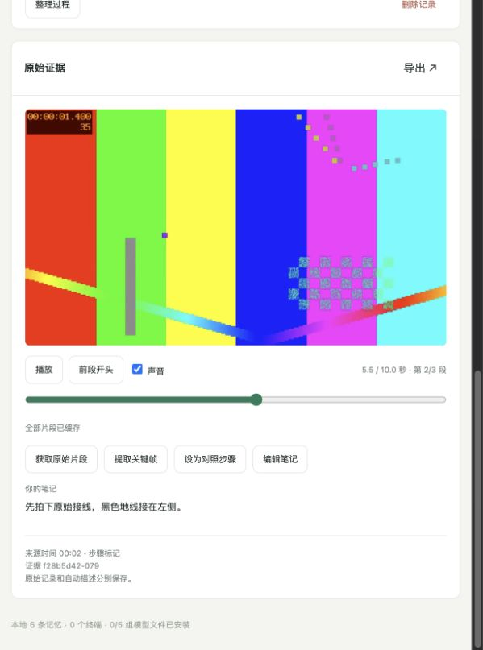

# 实板状态与验证记录

记录日期：2026-11-12。本文保存 0.1 核心首版在 RK3576 和 RV1106 的执行记录；当前功能开发见 `roadmap.md`。新版完成一小时 SD 录制：0 次音频 XRUN，702 个原件全量巡检通过，终端采样最低可用内存 21.59MiB。六下真实拍手的短测对齐偏差约 19–50ms，视频粒度约 40ms。旧版两次 XRUN 和压力短测 19.81MiB 的结果保留。零换页、整小时物理同步、真实 USB 直连及真实操作质量仍待验收。

## 已跑通的闭环

Echo-Mate 常驻服务采集摄像头和麦克风，生成分段 MP4、单声道 WAV、不可变事件日志和媒体清单。鲁班猫服务接收事件，按需获取原件、核验 SHA-256、建立索引并提取关键帧。Qt/浏览器可检索、回放、修正笔记、对照和导出证据；LVGL 终端已收到检索答案和原始画面缩略图。

录制、界面和 AI 分开运行。现场原件不会因中枢退出或 AI 任务失败而被替换成模型输出。启动脚本要求实际挂载 SD 卡；当前原件位于 `/mnt/sdcard/echotrace`，原 NAND 短测目录保留。

## 实测结果

| 项目 | 结果 | 证据与适用范围 |
|---|---|---|
| RV1106 原生核心 | 新版实板通过 | 协议、日志、WAV 和队列，含延后同步和相对路径检查 |
| RK3576 原生核心 | CTest 通过 | 与 RV 使用相同核心源码 |
| 此前完整 Python 回归 | RK3576 31 项全部通过；主机 30 项通过、1 项跳过 | 增加慢握手、持续分片途中重连、关闭连接、SD 迁移损坏与报告身份校验；主机跳过 Qt 实板用例 |
| 跨片段回放 | Qt 实际解码与浏览器交互通过 | 三段媒体自动续播、暂停后跳转、反向跳转、非零容器 PTS、缺口和未缓存片段；输入为明确标记的合成素材 |
| 浏览器控制回归 | 5 项通过 | 声画分段切换、暂停定位、缺口与未缓存处理、迟到下载回调、Blob URL 释放和纯音频回放 |
| 内存安全检查 | Qt 回放用例通过 AddressSanitizer | 检查项目 C++ 代码中的非法访问；`detect_leaks=0`，不作为第三方库泄漏检查或长时稳定性结论 |
| 录像与 LVGL 并发 | 1920×1080，25fps，H.264，209 帧/8.359422 秒 | 真实相机短测；不能替代长时丢帧统计 |
| 音频 | 16kHz、单声道、16bit PCM，8.22 秒 | 硬件双声道采集后选左声道 |
| Echo 普通内存 | 最低 MemAvailable 24,724kB，约 24.14MiB | 并发短测共 64 次采样；当时 GUI、录像和上传均启用 |
| Echo 媒体内存 | 最大 CmaAllocated 22,460kB；最低 CmaReleased 45,124kB | 该固件释放型 CMA 的 CmaFree 为 0，不能据此宣称 CMA 耗尽 |
| 媒体补传与取帧 | 原件摘要一致，生成 JPEG | 真实 RV→RK 链路；本次仍经临时 SSH 隧道 |
| MPP＋RGA | 实板解码、转换并输出 1920×1080 JPEG | 请求相对 3 秒，报告帧位置 3.039389 秒；这个差值不是声画同步误差 |
| 五组模型共存 | VAD、SenseVoice、BGE、Matcha/Vocos、Qwen 均执行成功 | 同一中枢实例，最低系统 MemAvailable 1,511,153,664 字节，约 1.41GiB |
| 一万条索引 | 100 次查询，P95 0.701 秒 | 随机归一化向量和模拟锚点，仅说明容量与查询延迟 |
| Echo 语音反馈 | 本地 TTS→校验传输→启动 ALSA 播放成功 | 未进行人工听辨或声学质量评测 |
| 新版一小时 SD 记录 | 342 段视频、360 段音频，0 次 XRUN | 702 个原件全部核验 SHA-256、样本表与 WAV；不等于全场视频像素解码 |
| 真实拍手短测 | 三组双击共六下，最大绝对偏差约 50.12ms | 逐帧视检与音频峰值配对，帧间隔约 40ms，有运动模糊；未经独立人工复核，未覆盖一小时 |
| 录制中容量保护 | 实际触发并安全停录，恢复被拒绝 | 调高预留阈值，无须填满 SD；错误持续显示，顶部告警可见 |
| 终端服务 | 所有权、重复启动、停止与重启通过 | 错误 PID 没有停止采集；独立重启没有改变采集 PID；未启用开机启动 |

本轮新增验证：[SD 长测](sd-hour-v6-summary.json)、[物理短测](physical-av-sync.md)、[BSP 构建](bsp-validation.md)、[容量保护](storage-reserve-live.json)、[界面服务](terminal-service.json)。主机和 RK3576 分别通过 8 项协议集成、2 项同步工具及 1 项人工结束协调器检查。此前完整 31 项回归的报告保留，本轮没有把子集检查写成重新执行完整套件。

详细数据：[并发采集](hardware-concurrent.json)、[模型共存](models-coexistence.json)、[索引负载](index-benchmark.json)、[MPP 日志](mpp-smoke.log)、[主机回归](tests-host.log)、[RK3576 回归](tests-rk3576.log)、[Qt 回放验证](playback-validation.json)、[AddressSanitizer 验证](playback-asan.json)。旧的 `vlm-smoke.json` 是单次试跑原始输出，其中视觉描述不作为事实或质量结论；模型共存记录使用了更中性的提示词。

CPU 冷调用样例约为 VAD 0.85 秒、ASR 7.34 秒、BGE 双文本 0.75 秒、TTS 9.16 秒；Qwen 关键帧描述约 23.74 秒。输入不同会改变耗时，不承诺这些值为端到端 P95。

## 已修复并验证的问题

- 语音派生锚点原先受到“ID 必须也是原始事件 ID”的外键限制。数据库版本 2 取消该限制，通过 `parent_event_id` 关联原始事件，保留会话和父事件的外键。迁移用例验证旧笔记、修订历史、任务和删除级联均保留。
- 音频分段边界采用前一段上下文，限制总窗口为 20 秒；子锚点保存参与转写的片段 ID 和样本来源时间。查询语音不会成为自己的答案。
- 导出先写临时包，对实际写入的字节计算摘要，成功后再提交；损坏原件和空间不足会拒绝导出。
- 终端支持完整中文字库和常用标点，记录页显示标记反馈；查询结果使用从原件提取的缩略图。
- 原播放器在暂停跳转时可能一直等待，在从关键帧回退解码时还会显示目标之前的画面。复用适配修复等待条件、丢弃目标前的帧并固定容器起点；测试解码不同颜色的真实 H.264 文件核对片段和位置。
- 文件结束时会排空解码器中的延迟 B 帧，避免切片时漏掉最后的画面。用例使用 25fps、含 B 帧的两秒素材，首段实际显示 50 帧后再续播。
- 只有声音的证据也支持续播、暂停和跨段定位。浏览器以音频元素为播放时钟；Qt 的 Echo 音频进度以命令确认后的单调时钟估算，声学进度误差仍待物理测试。
- 修复采集故障仅显示“已暂停”的提示缺口。故障原因不会被后台命令清除，存储不足直接出现在终端顶部；故障状态禁止直接恢复，需结束会话后重新开始。
- 旧启动周期的 `paused` 日志重放曾令中枢拒绝 `session.reconcile` 并断开终端，现仅确认同设备旧会话的结束状态，其余过时状态得到确认但不改写当前会话。真实 WebSocket 回归通过，更新后原件补传和 AI 任务恢复，见 [集成短测](deskbot-integration-test-2026-11-13.md)。
- AI 队列满时省略的低优先级画面描述现在由空闲 worker 限量补建；只选择已有视频时间覆盖的锚点，避免无媒体事件长期占据待处理队列。实板验证和任务数量见 [集成短测](deskbot-integration-test-2026-11-13.md)。



在 RK3576 复现回放检查：

```sh
cmake --build build/rk3576 --target echotrace-playback-test -j4
PYTHONPATH=src .venv/bin/python -m unittest discover -s tests -p test_playback.py -v
cmake -S . -B build/playback-asan -DECHO_BUILD_QT=ON -DECHO_BUILD_EDGE=OFF \
  -DCMAKE_BUILD_TYPE=Debug -DCMAKE_CXX_FLAGS='-fsanitize=address -fno-omit-frame-pointer' \
  -DCMAKE_EXE_LINKER_FLAGS='-fsanitize=address'
cmake --build build/playback-asan --target echotrace-playback-test -j4
ASAN_OPTIONS=detect_leaks=0 ECHOTRACE_QT_PLAYBACK=build/playback-asan/echotrace-playback-test \
  PYTHONPATH=src .venv/bin/python -m unittest discover -s tests -p test_playback.py -v
```

## 当前边界

- 历史 AI 任务取片和新媒体请求共用源端串行传输队列，繁忙时新请求会等待。交互取片延迟尚未验收；本轮部分短测原件经 SSH 读回并核验摘要，没有把该过程算作正常取片性能。

- 已支持证据范围内的跨片段续播、全范围跳转和声画联动。切片切换可能出现短暂加载；Qt 的 Echo 声音命令顺序通过桩服务器验证，物理扬声器与画面的同步误差仍需实板长测，尚未达到一小时同步验收。
- 语音查询在录制期间处理闭合音频段，存在分段及转写等待；停止录制后使用文字查询。半双工回放区间会排除用户笔记转写，实时 Opus 低延迟对话尚未接入。
- 当前相机画面并非固定工作台操作视角，尚不能据此评价接线细节、遮挡和工具身份。
- 20 次真实操作、200 条人工问题、Recall@5、负例拒答率及三组对比实验尚未采集或报告。模拟素材不能补充这些指标。
- USB 直连、完整 BSP 镜像和开机部署仍待完成；App 操作使用现有触屏和语音。

## 后续实体验收

1. 新版一小时采样内存余量已高于 20MiB；继续检查此前压力低值及 RK3576 的 zram 换页，不能宣称零换页门槛已通过。
2. 已有六下拍手短测，继续完成一小时物理声画同步与真实回放测量。
3. 验证 USB 断线期间继续记录、重连补传、重启恢复和容量不足退出，再按可控步骤验证异常断电恢复。
4. 固定工作台机位，采集独立操作会话和人工题集，使用 `scripts/evaluate.py` 报告质量指标。

恢复、构建和最终板间网络配置见 [部署说明](deployment.md)。
